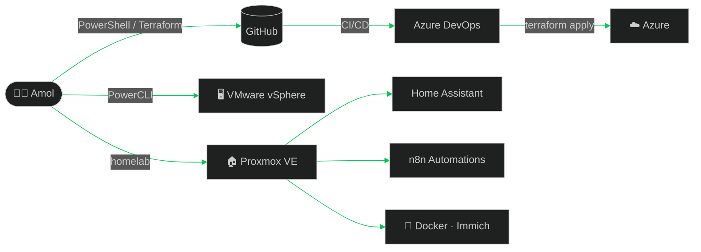

<!-- ============ SAMPLE V5 : "Green Terminal" — v2 colours & banner + v1 content + AP Shell logo ============ -->

<p align="center">
  
</p>

<!-- Logo on the left, intro on the right -->
<a href="https://apshell.wordpress.com"></a>

### Amol Patil · `AP Shell`

**Infrastructure & Automation Engineer** · Texas, USA


<a href="https://www.linkedin.com/in/amolsp777"></a>
<a href="https://apshell.wordpress.com"></a>
<a href="mailto:pscriptsasp@gmail.com"></a>

<a href="https://github.com/amolsp777?tab=followers"></a>


<br clear="left"/>

<p align="center">
  
</p>

---

### `$ Get-Engineer | Format-List`

```powershell
PS C:\> Get-Engineer -Name 'Amol Patil' | Format-List

Name        : Amol Patil
Location    : Texas, USA
Role        : Infrastructure & Automation Engineer
Passion     : Turning repetitive admin work into PowerShell scripts
Focus       : {Azure, Terraform, Azure DevOps, CI/CD}
Platforms   : {Windows Server, VMware vSphere, Proxmox VE, Active Directory}
Homelab     : {Home Assistant, n8n, Docker, Immich}
Learning    : Every new challenge that comes along 🌱
Blog        : https://apshell.wordpress.com
FunFact     : If I do it twice, I script it the third time ⚡
```

---

### `$ Get-Status -Now`

| | |
|:--|:--|
| 🔨 **Building** | Terraform modules + Azure DevOps CI/CD pipelines |
| 🖥️ **Running** | VMware vSphere · Proxmox VE · Windows Server |
| 🔐 **Managing** | Active Directory · server inventory & reporting |
| 🏠 **Homelab** | Home Assistant · n8n workflows · Docker · Immich |
| 📚 **Learning** | Azure DevOps end-to-end · every new challenge 🌱 |
| 💬 **Ask me about** | PowerShell, PowerCLI, automating anything repetitive |

<!-- Uncomment and fill in when you want to show certifications
### `$ Get-Certification`

<p>
  
  
</p>
-->

---

### `$ Get-Module -ListAvailable`

<p align="center">
  
</p>

<p align="center">
  
  
  
  
  
  
  
</p>

---

### `$ Get-ChildItem .\repos | Sort-Object Favourite`

| Project | What it does | Stack |
|:--|:--|:--|
| ⚙️ [**PowerShell_Scripts**](https://github.com/amolsp777/PowerShell_Scripts) | Collection of admin scripts for day-to-day infrastructure tasks |  |
| 💾 [**Get-Datastore-Utilization**](https://github.com/amolsp777/Get-Datastore-Utilization) | VMware datastore utilization & summary HTML report (v2) |  |
| 🖥️ [**Server-Inventory**](https://github.com/amolsp777/Server-Inventory) | Automated Windows server inventory collection |  |
| ☁️ [**Terraform**](https://github.com/amolsp777/Terraform) | Terraform notes and infrastructure-as-code samples |  |
| 🔐 [**Active-Directory**](https://github.com/amolsp777/Active-Directory) | Active Directory notes and handy commands |  |
| 🏠 [**ProxmoxPVE**](https://github.com/amolsp777/ProxmoxPVE) | Proxmox VE homelab configs and notes |  |

---

### `$ Get-Homelab | Show-Topology`



---

### `$ Measure-Object -Contributions`

<p align="center">
  
</p>

<table align="center">
  <tr>
    <td></td>
    <td></td>
  </tr>
  <tr>
    <td></td>
    <td></td>
  </tr>
</table>

<p align="center">
  
</p>

---

### `$ Start-Snake -Mode Contributions` 🐍

<p align="center">
  <picture>
    <source media="(prefers-color-scheme: dark)" srcset="https://raw.githubusercontent.com/amolsp777/amolsp777/output/github-snake-dark.svg"/>
    <source media="(prefers-color-scheme: light)" srcset="https://raw.githubusercontent.com/amolsp777/amolsp777/output/github-snake.svg"/>
    
  </picture>
</p>

---

<details>
<summary><b>✍️ <code>$ Get-Content .\blog\latest.rss</code> — click to expand</b></summary>
<br/>

<!-- BLOG-POST-LIST:START -->
- [Visit AP Shell blog](https://apshell.wordpress.com) — posts appear here automatically once the workflow runs
<!-- BLOG-POST-LIST:END -->

</details>

---

### `$ Get-Quote -Random`

<p align="center">
  
</p>

---

### `$ Connect-Amol`

<p align="center">
  Got a script idea, an automation problem, or just want to talk homelabs? Let's connect!<br/><br/>
  <a href="https://www.linkedin.com/in/amolsp777"></a>
  <a href="https://apshell.wordpress.com"></a>
  <a href="mailto:pscriptsasp@gmail.com"></a>
  <a href="https://github.com/amolsp777?tab=repositories"></a>
</p>

<p align="center">
  
</p>
<p align="center"><code>exit 0</code> — thanks for stopping by! ⭐</p>
